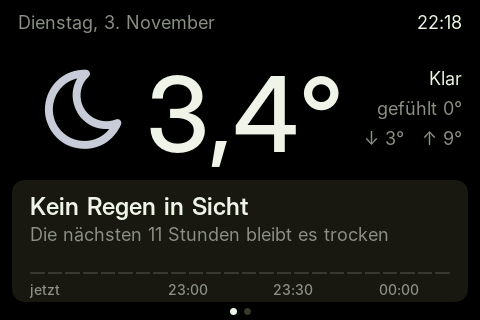
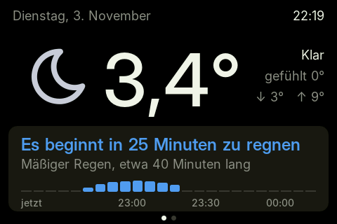
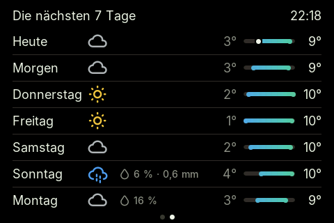
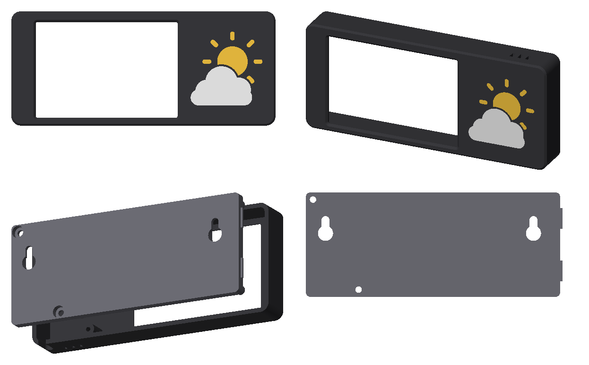
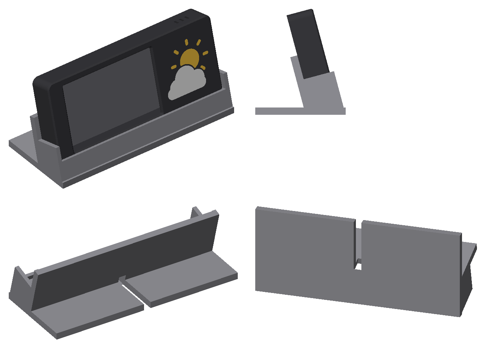

# Weather Display

A wall-mounted weather display for the **ESP32-3248S035C**, the 3.5" "Cheap Yellow Display" with a capacitive touchscreen. It shows the temperature and tells you when rain starts or stops, based on the German Weather Service's (DWD) rain radar. A second page shows the next seven days. Includes a 3D-printable case with a multi-color sun-and-cloud emblem.

| Now | When rain is coming | Next 7 days |
| --- | --- | --- |
|  |  |  |

The display's texts are in German.

## What it shows

- **Page 1:** today's date, the time, the weather as an icon, the temperature, what it feels like, and today's low and high.
- **Rain card:** a sentence about the rain, such as *"Es beginnt in 25 Minuten zu regnen"* ("rain starts in 25 minutes") or *"Es hört in 40 Minuten auf zu regnen"* ("rain stops in 40 minutes"), with how heavy it is and how long it lasts. Below it, the next two hours as bars in steps of five minutes.
  - Below 1 °C, it talks about snow instead of rain.
  - When no rain is in the radar's reach, the forecast model takes over: *"Trocken bis etwa 17:15"* ("dry until about 17:15").
- **Page 2:** the next seven days. Each row has the day's icon, the chance and amount of rain, and its low and high as a bar. All bars share one scale for the week, so warm and cold days stand out.
- **Touch:** a tap anywhere switches pages. Page 2 returns to page 1 after a minute.

## Where the data comes from

Both services are free and need no account or API key.

| What | Source | How often |
| --- | --- | --- |
| Rain in the next 2 hours, every 5 minutes | DWD rain radar (RADOLAN RV), via [Bright Sky](https://brightsky.dev) | every 5 minutes |
| Temperature, rain beyond 2 hours, 7 days | [Open-Meteo](https://open-meteo.com) | every 10 minutes |

The radar sees rain that is already falling and where it is moving. That is what makes "in 25 minutes" worth trusting. Radar data is only available for Germany.

## Hardware

- **ESP32-3248S035C:** ESP32-WROOM, ST7796 480×320 display, GT911 capacitive touch.
  - The resistive version (`…035R`, XPT2046 touch) needs a different touch driver in `src/touch.cpp`.
- **USB cable** for power. In the case, the plug points right and the cable bends down inside the case.

## Building and flashing

You need [PlatformIO](https://platformio.org) (`pio`).

```sh
pio run -e cyd35 -t upload
```

On first boot, the display opens a Wi-Fi network called **Wetter-Display**:

1. Connect to it with your phone. The setup page opens on its own; if it doesn't, go to `192.168.4.1`.
2. Choose your Wi-Fi and enter its password.

To forget the Wi-Fi, keep a finger on the screen while powering on.

## Customizing

| What | Where |
| --- | --- |
| Place (name, latitude, longitude) | `include/config.h` |
| Time zone, host name, refresh intervals, pin numbers | top of `src/main.cpp` |
| Wording of the rain messages, when it counts as rain (`WET_MMH`) | `src/weather.cpp`, `src/weather.h` |
| Colors | `src/ui.h` |
| Layout of the pages | `src/now.cpp`, `src/week.cpp` |
| Fonts, icons, sizes | `tools/make_fonts.py`, then regenerate (see below) |

### Fonts and icons

`TFT_eSPI`'s built-in fonts only cover ASCII. The display needs umlauts, "°" and weather icons, so `tools/make_fonts.py` renders anti-aliased fonts from [Inter](https://rsms.me/inter/) and the [Tabler icons](https://tabler.io/icons) into `src/fonts.cpp`. Both are in `tools/vendor`.

To add an icon or a character, edit the lists in the script and run:

```sh
uv run --no-project --with pillow python tools/make_fonts.py
```

### Screenshots and debugging

The panel's MISO line isn't wired, so the display can't be read back. Instead, the firmware draws the current page a second time and sends that as a screenshot. There are two ways to get one:

- **Over Wi-Fi:** `http://wetter-display.local/screen.bmp`. To tap without a finger, send `POST /tap`.
- **Over USB:** for networks that keep devices apart, such as many IoT networks.

  ```sh
  uv run --no-project --with pyserial python tools/screenshot.py screen.png          # page 1
  uv run --no-project --with pyserial python tools/screenshot.py week.png --tap      # page 2
  uv run --no-project --with pyserial python tools/screenshot.py rain.png --demo=r   # made-up rain
  ```

  `--demo=r` fakes rain starting in 25 minutes, and `--demo=R` rain that stops in 20. Either way, the next real radar update replaces it within 5 minutes.

## The case



A frame for the wall, in landscape, 139.7 × 60.4 × 18.5 mm. A wing on the right makes room for the USB plug: the cable bends down inside and leaves at the bottom. The wing carries a sun-and-cloud emblem, printed in color as an inlay in the first layers.

### Files

Everything is in `enclosure/`. The STLs already lie the way they print.

| File | What |
| --- | --- |
| `front.stl` | the frame with the display window, printed front face down |
| `sun.stl`, `cloud.stl` | the emblem, 0.6 mm inlays in the front |
| `back.stl` | the lid, with keyholes for the wall |
| `fit-test.stl` | the front's first 4 mm, a 15-minute print to check the fit first |
| `stand.stl` | a desk stand to put the case in, as an alternative to the wall (see below) |

### Printing in color (Bambu Studio with AMS)

1. Import `front.stl`, `sun.stl` and `cloud.stl` **in one go**.
2. Answer **Yes** when asked whether to load them as one object with several parts. They share one origin, so the emblem lands in its pockets.
3. Under *Project Filaments*, set up a filament per color, or sync them from the AMS.
4. In the object list, click each part's filament number and give `front`, `sun` and `cloud` their own filaments, for example black, yellow and white.
5. Print `back.stl` on its own or on the same plate.

The color only changes in the first three layers at 0.2 mm, so very little filament is purged. The front takes on the plate's surface: textured PEI gives a matte front.

### Assembly and mounting

1. Put the board in the frame, display facing forward.
2. Put the cable into the slot at the bottom right.
3. Hook the lid's tongues into the left wall, close the lid, and fix it with two **3 × 10 mm sheet-metal screws**.
4. On the wall, put two **3.5 mm countersunk screws** (for example Spax 3.5 × 25) **110 mm apart** at the same height, with their heads standing **4–5 mm** off the wall.
5. Hang the case on them and let it drop into place.

### Desk stand



To stand the display on a desk instead of hanging it, print `enclosure/stand.stl`. It is one piece, printed as it stands, without supports. The case drops in from above and leans back 15°:

- A low lip in front holds the case and stays below the image.
- A rest behind supports it, and a foot keeps it from tipping when you tap the screen.
- Walls on the left and right follow the case's rounded corners, with 0.4 mm of play, so it can't slide sideways.
- The cable leaves the case at the bottom right and lies in a channel in the cradle's floor, hidden under the case. In the middle, the channel turns toward the back in a wide curve and runs out under the foot.
- Lay the cable into the channel before putting the case in. It leaves at the back, in the middle.

### Changing the case

The case is built in code with [build123d](https://build123d.readthedocs.io). Every dimension is a named value at the top of `enclosure/enclosure.py`: the board's measurements, where the image sits on the board, wall thickness, the wing, the screws, the cable. The stand's tilt, lip, rest and foot are at the top of `enclosure/stand.py`; it takes the case's dimensions from `enclosure.py`. After changing anything, rebuild the STLs and the previews:

```sh
uv run --no-project --python 3.12 --with build123d python enclosure/enclosure.py
uv run --no-project --python 3.12 --with build123d python enclosure/stand.py
uv run --no-project --python 3.12 --with trimesh --with rtree --with pillow --with numpy --with scipy python enclosure/render.py
```

## How it's built

- `src/main.cpp`: setup, Wi-Fi, the loop, touch, and the screenshot endpoints.
- `src/weather.cpp`: fetching the data and the rain logic.
  - Bright Sky sends radar frames as base64-encoded, zlib-compressed pixel arrays. They are unpacked with the inflate routine in the ESP32's ROM.
- `src/now.cpp`, `src/week.cpp`: the two pages.
- `src/ui.cpp`: helpers, weather icons, colors.
  - The screen is drawn through a 480 × 40 sprite, one strip at a time, so drawing fits in the heap next to Wi-Fi and TLS.
- `src/touch.cpp`: a minimal GT911 driver.

## Licenses

- The code and the case are under the [MIT License](LICENSE).
- [Inter](https://rsms.me/inter/) is under the SIL Open Font License; see `tools/vendor/Inter-LICENSE.txt`.
- The [Tabler icons](https://tabler.io/icons) are under the MIT License; see `tools/vendor/tabler-icons-LICENSE`.
- Weather data:
  - [Open-Meteo](https://open-meteo.com), under [CC BY 4.0](https://creativecommons.org/licenses/by/4.0/). It is free for non-commercial use.
  - Radar: © [Deutscher Wetterdienst](https://www.dwd.de), via [Bright Sky](https://brightsky.dev).
